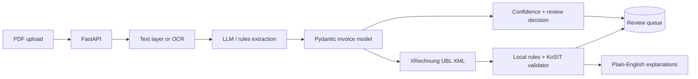

# Architecture

## Target design (built up over five weeks)

The application is a modular monolith: FastAPI for HTTP, Pydantic for validated domain
objects, and services that isolate PDF/OCR, extraction, XML generation and validation.

## What exists at the end of week 1

Only the foundation: settings, PII-redacting logging, the invoice domain schema, the job
status vocabulary, the FastAPI app with `/health` and `/api/v1/invoices/capabilities`, tests
and CI. Everything in the diagram beyond the FastAPI box is planned for later weeks, and the
capabilities endpoint reports it as not available.

## Trust boundaries

- Uploaded files are untrusted input.
- OCR text and LLM output are untrusted until parsed and validated.
- Well-formed XML is not compliant XML; an official validator result is recorded separately
  from model confidence.
- Low-confidence, inconsistent or incomplete extractions go to a person.

## The domain schema is deliberately lenient

`app/models/invoice.py` makes every value optional. A missing mandatory value is a *finding*
(week 4 rule checks), not an exception, so a partial extraction can still be shown to a
reviewer. Constraints (non-negative amounts, 3-letter currency, and so on) still apply to
values that are present. Totals are not cross-checked in the schema so that documents with
wrong printed totals can be represented faithfully and then flagged.
